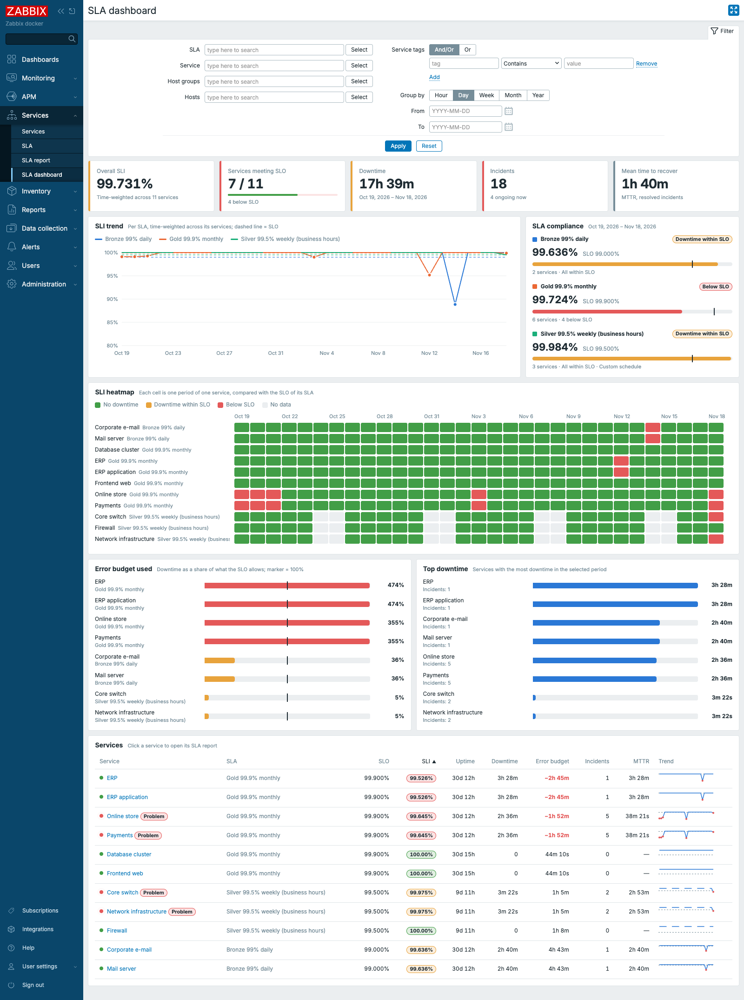
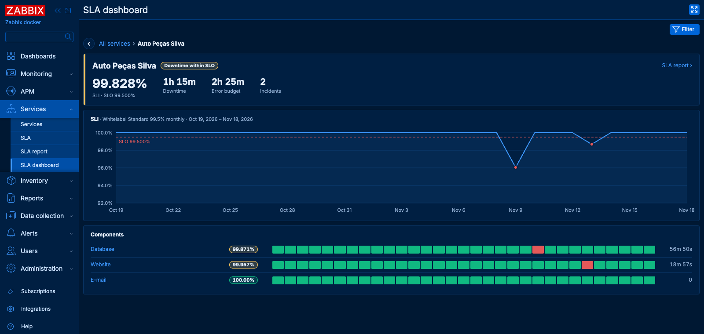
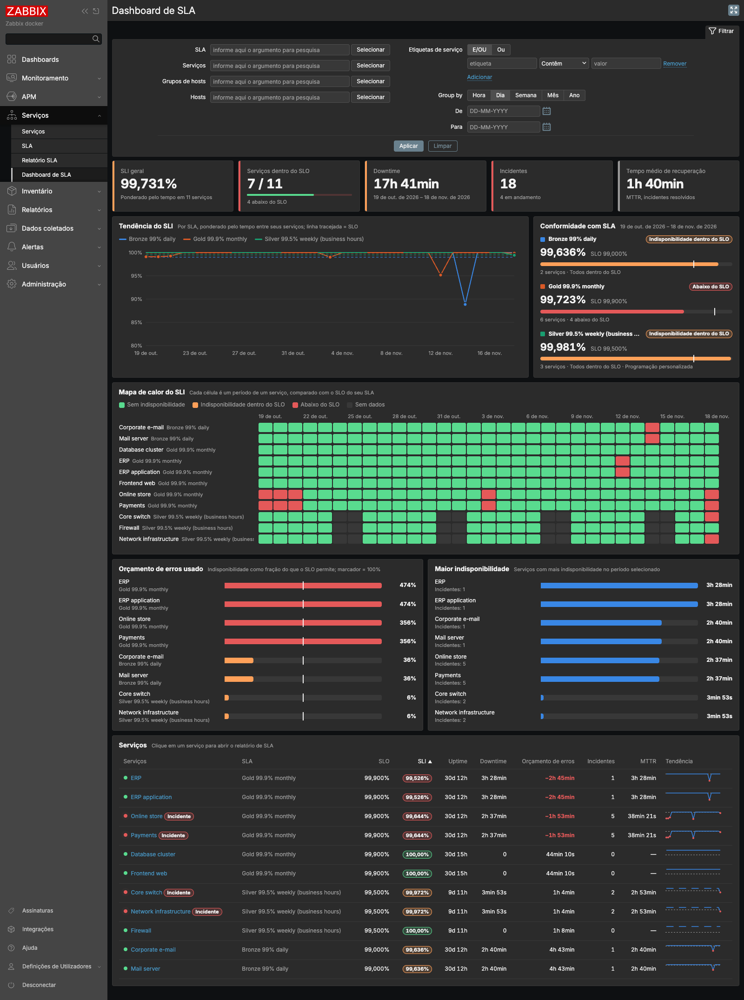

# SLA dashboard for Zabbix 8.0

A frontend module that adds **Services → SLA dashboard** to Zabbix 8.0: a visual view of how your IT services are doing against their SLAs, with the same filters you already know from the SLA report, Services and Problems pages.



## What it shows

The page follows the Zabbix service tree, so it stays readable with one service or with hundreds of customers of a whitelabel provider.

- **Overview**: one card per top service, that is, a service with an SLA that has no ancestor with an SLA (each customer, for example). Each card shows the SLI, the SLO and one status bar per period: no downtime, downtime within the SLO, below the SLO, or no data. Cards are sorted worst first and grouped by their parent without an SLA (e.g. the provider). With a single top service, the page opens it directly.
- **Service**: click a card to see its SLI against the SLO, downtime, error budget and incidents, one SLI chart for the period, and its **components**: the child services, each with its own status bars. A child without an SLA of its own (for example, when the SLA matches a tag that only the parent has) is measured with the parent's SLA. Components with children open the same way; the trail at the top goes back. A service in more than one SLA gets one tab per SLA. "SLA report" opens the native report for that service ("Service" for a child measured with the parent's SLA, which the native report does not list).

The path is kept in the URL, so the browser's back button works and a link opens the same service. The page refreshes every minute.

## Filters

| Filter | Same as |
| --- | --- |
| SLA, Service | Services → SLA report (several at once here; a service brings its child services) |
| Host groups, Hosts | Monitoring → Problems. A service belongs to a host when its problem tags match the tags a problem of that host would carry (trigger, item, host and template tags); parent services come along |
| Service tags | Services → Services (And/Or, Or, all tag operators) |
| Group by: Hour, Day, Week, Month, Year | — |
| From / To | Services → SLA report (dates). Empty = last 24 hours, 30 days, 12 weeks, 12 months or 5 years, by the grouping |

The filter is stored in the user profile, like the core pages, and starts collapsed.

## How the SLI is calculated

Exactly like Zabbix's own SLA report (`sla.getsli` in the 8.0 frontend): service status history (`service_alarms`, read through `service.get` with `selectStatusTimeline`), the SLA schedule, excluded downtimes, the service creation time and the SLA effective date. The only difference is that periods can be any hour, day, week (starting on Sunday, as in Zabbix), month or year, in any date range. `tests/lab/parity.py` checks the numbers against `sla.getsli` cell by cell.

Everything goes through the Zabbix API with the logged-in user's session, so permissions apply as in the SLA report. Access needs the **SLA report** UI element in the user role.

## Themes and languages

- Follows the user's theme: Blue, Dark, Dark blue, Blue (classic), Dark (classic), High-contrast light and dark.
- Follows the user's language. Labels that Zabbix already translates (SLA, SLO, SLI, Uptime, Downtime, Error budget…) come from the core translation; the rest of the module ships its own gettext files for the 39 languages of Zabbix 8.0. Numbers and dates use the user's locale.

| A customer, Dark blue | Português (Brasil), Dark |
| --- | --- |
|  |  |

## Install

Requires Zabbix 8.0 (frontend). On the frontend server, as root:

```sh
curl -fsSL https://raw.githubusercontent.com/daniel-nasiloski-wct/zabbix-sla-dashboard/main/install.sh | sh
```

Then, as a Super admin: **Administration → General → Modules → Scan directory**, enable **SLA dashboard**, and open **Services → SLA dashboard**.

The installer only creates `<frontend>/modules/sla_dashboard`: no core file, configuration, database table or service is changed, and nothing is restarted. Other options:

```sh
sh install.sh status
sh install.sh uninstall
sh install.sh --ref v1.0.0            # a tag or branch
ZABBIX_FRONTEND_DIR=/usr/share/zabbix/ui sh install.sh
ZABBIX_URL=https://zabbix.example.com/api_jsonrpc.php ZABBIX_TOKEN=<token> sh install.sh   # also enables it
```

Manual install: copy the `sla_dashboard` directory to `<frontend>/modules/` (for packages, `/usr/share/zabbix/ui/modules/`; for the official Docker image, `/usr/share/zabbix/modules/`) and enable it as above.

## Development

```sh
cd tests/lab && docker compose up -d     # Zabbix 8.0 (official images) + PostgreSQL, http://localhost:8090, Admin/zabbix
python3 tests/lab/seed.py                 # hosts, triggers, services, 3 SLAs and ~400 days of status history
python3 tests/lab/seed_whitelabel.py      # whitelabel provider with 12 customers (--customers 40 for scale)
python3 tests/lab/api.py module.create '{"id":"sla_dashboard","relative_path":"modules/sla_dashboard","status":1}'
python3 tests/lab/sender.py pay-api-01 1  # opens a real problem (0 closes it)
python3 tests/lab/parity.py               # SLI of the module vs sla.getsli
python3 tests/lab/filters.py              # host, group, tag, service and period filters
tests/lint.sh                             # php -l (8.1), node --check, sh -n
tests/i18n.sh                             # .po → .mo, fails on missing translations
```

The module directory is mounted into the frontend container, so changes show up on reload. No build step: plain PHP, one CSS file and one JavaScript module, without libraries.

Any new visible text in the JavaScript goes through `t('…')` (the PHP reads the list straight from the file). Texts Zabbix does not translate also go to `sla_dashboard/locale/sla_dashboard.pot` and to every `.po`; run `tests/i18n.sh` afterwards.

## License

MIT
